# AWS Two-Tier To-Do Application Deployment

## Project Overview

In this project, I deployed a To-Do List web application on AWS using two EC2 instances, an RDS MySQL database, and an Application Load Balancer.

The goal was to practice AWS networking, application deployment, database connectivity, and load balancing through a hands-on project.

The application allows users to add, view, update, and delete tasks.

## AWS Services and Tools

- **Amazon VPC:** Created a custom network with two public and two private subnets across two Availability Zones.
- **Amazon EC2:** Deployed the Node.js application on two instances.
- **Amazon RDS MySQL:** Used a private database to store tasks.
- **Application Load Balancer:** Routed application traffic between the two EC2 instances.
- **Security Groups:** Configured network access between AWS resources.
- **Internet Gateway and Route Tables:** Configured network routing.
- **Bastion Host:** Connected to the private RDS database from an EC2 instance.
- **Nginx:** Used as a reverse proxy for the Node.js application.
- **PM2:** Managed the application processes.
- **Git and npm:** Downloaded the application code and installed its dependencies.

## How It Works

1. A user opens the application through the ALB DNS address.
2. The ALB forwards the request to one of the two EC2 instances.
3. Nginx forwards the request to the Node.js application.
4. The application reads or updates data in the RDS MySQL database.
5. Both EC2 instances use the same database, so users can access the same tasks.

## Testing

I tested the deployment by:

- Opening the application through the ALB.
- Checking that both EC2 instances were healthy in the Target Group.
- Adding tasks and confirming they remained after refreshing the page.
- Testing the application API using curl.
- Checking that API requests used the ALB address.

## Challenges and What I Learned

During deployment, I worked through several issues:

- Fixed an Nginx configuration conflict that initially displayed the default welcome page.
- Investigated a `502 Bad Gateway` error and found a port conflict affecting the Node.js process.
- Fixed a `503 Service Temporarily Unavailable` error by registering the EC2 instances in the Target Group.
- Corrected API configuration issues that prevented tasks from appearing in the browser.

These issues helped me better understand Linux commands, networking, application processes, and troubleshooting on AWS.

## Application Source

The original To-Do List application code comes from the educational repository [Todo-Two-Tier](https://github.com/Himanshu-Sangshetti/Todo-Two-Tier).

My hands-on work focused on configuring the AWS infrastructure, deploying the application, connecting the database, troubleshooting issues, and testing the final deployment.

## Project Screenshots

The following screenshots document the AWS infrastructure, application deployment, and testing process.

### 1. AWS Network Setup

**VPC Resource Map**

Created a custom VPC with four subnets across two Availability Zones.

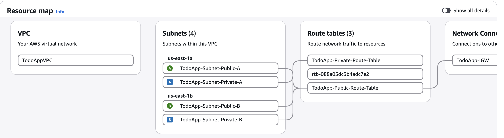

**VPC Subnets**

Configured two public subnets for the web servers and two private subnets for the database network.

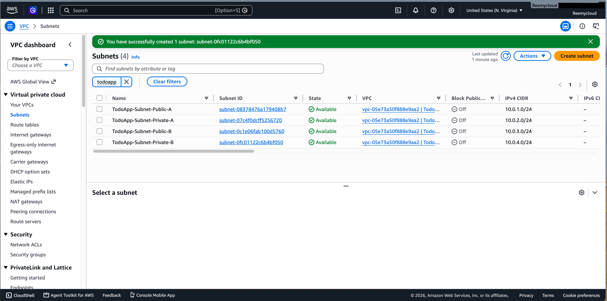

**Internet Gateway**

Attached an Internet Gateway to the custom VPC to support internet connectivity for the public subnets.

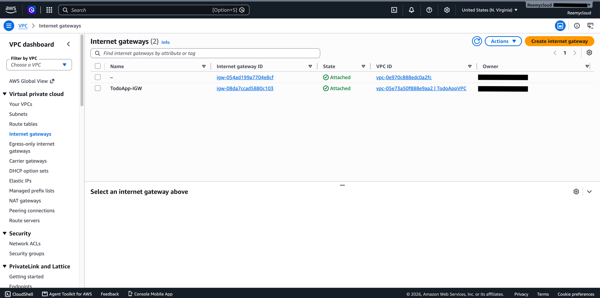

**Public Route Table**

Configured a route to the Internet Gateway for internet-bound traffic.

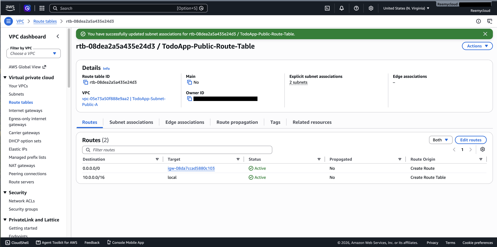

**Public Subnet Associations**

Associated both public subnets with the public route table.

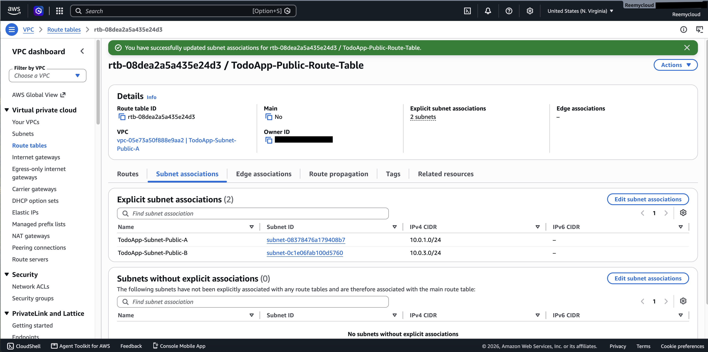

**Private Route Table**

Associated the two private subnets with a separate route table.

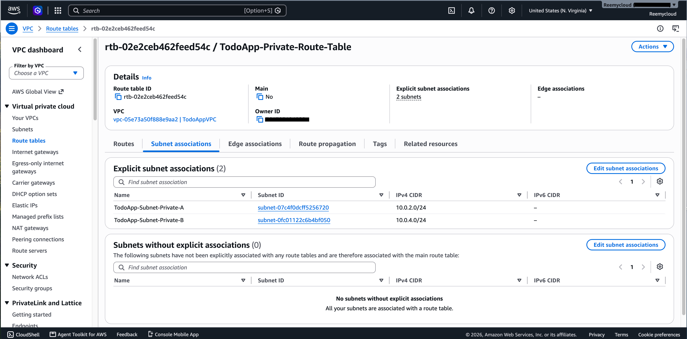

### 2. Security and Database

**Security Groups**

Created security groups to manage network access for the web servers, load balancer, and database.

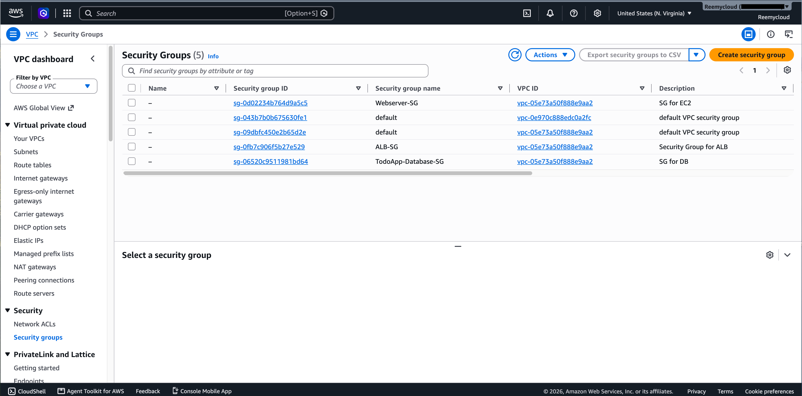

**RDS Private Network**

Configured the RDS MySQL database without public access.

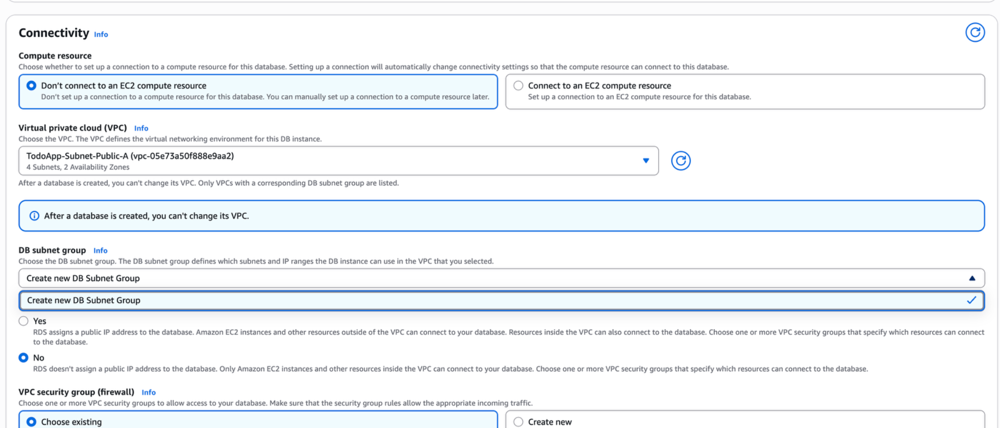

### RDS Connectivity

Configured the database security group to allow access from the web server security group.

**MySQL Database Schema**

Created the To-Do database and the Tasks table using SQL commands.

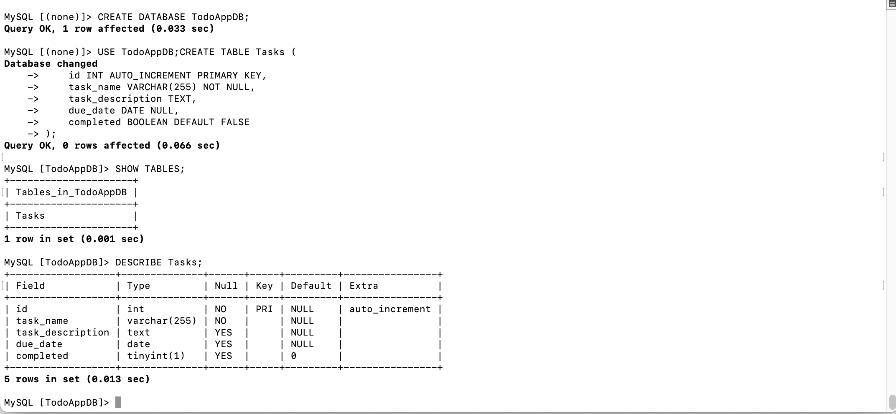

### 3. Application Deployment

**EC2 Instances**

Launched two web server instances across different Availability Zones and a Bastion Host for database administration.

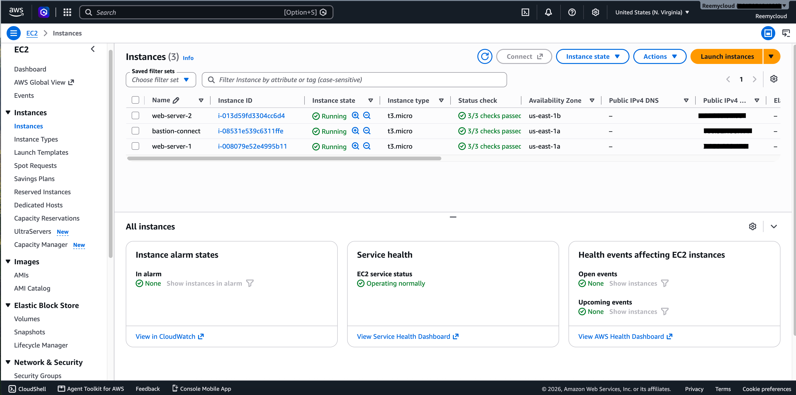

**PM2 Application Status**

Used PM2 to manage the Node.js application process and confirmed that it was online.

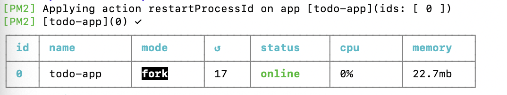

**API Testing**

Tested the application API using curl and received a successful HTTP 200 response with task data.

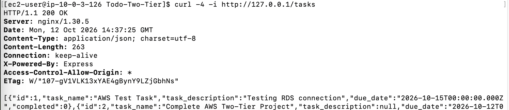

### 4. Load Balancing and Final Testing

**Application Load Balancer**

Configured an internet-facing Application Load Balancer with an HTTP listener on port 80.

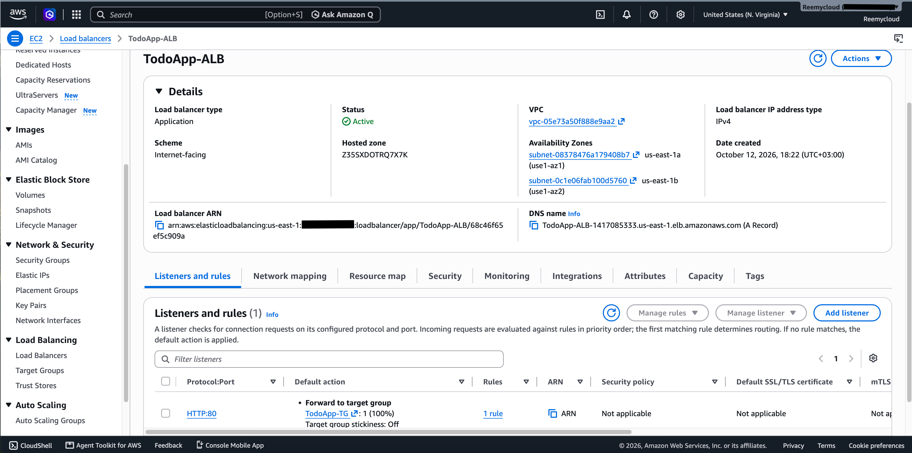

**Healthy Targets**

Registered both EC2 web servers in the Target Group and confirmed that both passed their health checks.

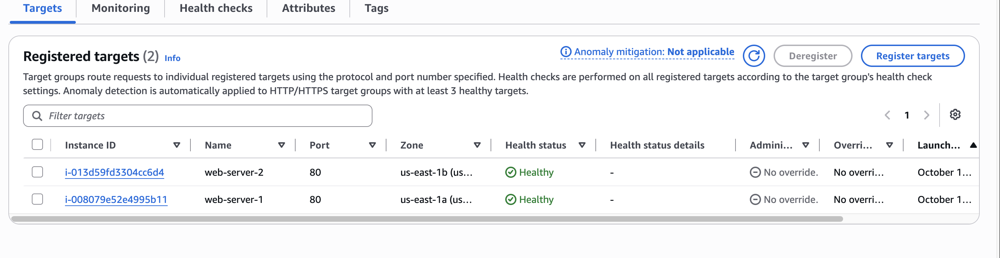

**Final Application**

Successfully accessed the To-Do List through the ALB DNS address and confirmed that the saved tasks were displayed.

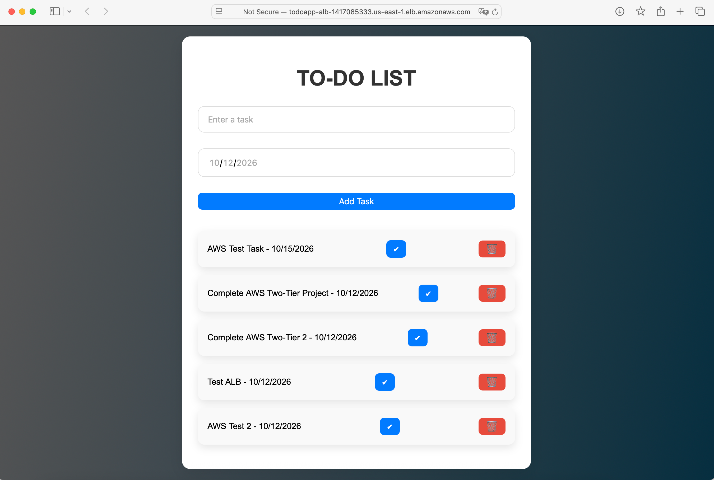

### 5. Architecture Diagram

The architecture diagram will be added here to illustrate the relationship between the VPC, public and private subnets, EC2 instances, ALB, and RDS MySQL database.

## Future Improvements

This project was built as a hands-on learning experience. In the future, I would like to improve it by:

- **HTTPS:** Add an SSL/TLS certificate using AWS Certificate Manager.
- **Security:** Restrict SSH access and allow web server traffic only from the ALB security group.
- **Auto Scaling:** Automatically adjust the number of EC2 instances based on traffic.
- **Monitoring:** Use Amazon CloudWatch to monitor application performance and resource usage.
- **Infrastructure as Code:** Use Terraform or AWS CloudFormation to automate the infrastructure setup.

## Project Status

The application was successfully deployed and tested on AWS.

After completing the project and saving the documentation, I deleted the AWS resources to avoid ongoing cloud costs. The live application is no longer available, but the screenshots above show the deployment and testing results.
